# DER fisico do banco DataJud

Este documento descreve o modelo fisico/canonico que sera materializado para apoiar a geracao do XML DataJud.

Referencias:
- Estrutura do XML/XSD: `docs/processojudicial-estrutura.md`
- DER conceitual derivado do XSD: `docs/der-processojudicial-xsd.md`
- XSD original: `utils/modelo-de-transferencia-de-dados-1.2.xsd`

Decisoes atuais:
- Complementos textuais e nacionais sao consolidados em `tb_datajud_evento_complemento`.
- `tb_datajud_evento_complemento_texto` e `tb_datajud_evento_complemento_nacional` nao serao materializadas.
- `tb_datajud_evento_oj` e `tb_datajud_evento_classe` nao serao materializadas.
- OJ e classe dos eventos serao atribuidos pela vigencia do processo.

## DER

```mermaid
erDiagram
  tb_datajud_processo {
    decimal nr_processo PK
    int cd_comp_tj
    int cd_classe
    int nivel_sigilo
    boolean intervencao_mp
    bigint tamanho_processo_bytes
    datetime data_ajuizamento
    int proc_el
    int dsc_sistema
    boolean juizo_100_digital
    string sigla_tribunal
    string grau
    boolean pedido_prioridade
    decimal valor_causa
    decimal custas_recolhidas
    int cd_oj_tj
  }

  tb_datajud_processo_oj {
    decimal nr_processo FK
    int cd_sist_origem
    int cd_tb_origem
    string cd_seq_tb_origem
    int cd_evento
    int cd_oj_tj
    datetime dth_incl_oj
  }

  tb_datajud_processo_oj_vigencia {
    decimal nr_processo FK
    int cd_sist_origem
    string cd_seq_tb_origem
    int cd_oj_tj
    int cd_oj_cnj
    datetime dt_ini_vig_oj
    datetime dt_fim_vig_oj
  }

  tb_datajud_processo_classe_vigencia {
    decimal nr_processo FK
    int cd_sist_origem
    string cd_seq_tb_origem
    int cd_classe
    datetime dt_ini_vig_classe
    datetime dt_fim_vig_classe
  }

  tb_datajud_processo_evento {
    decimal nr_processo FK
    int cd_sist_origem
    int cd_tb_origem
    string cd_seq_tb_origem
    int cd_evento
    datetime dth_evento
    int nivel_sigilo
    string cpf_resp_evento
    int cd_tp_resp_evento
    boolean fl_evento_ativo
  }

  tb_datajud_evento_complemento {
    decimal nr_processo FK
    int cd_sist_origem
    int cd_tb_origem
    string cd_seq_tb_origem
    int cd_evento
    int cd_compl
    string cd_compl_tab
    string ds_vlr_compl
    datetime dth_evento
    boolean in_ativo
  }

  tb_datajud_evento_magistrado_prolator {
    decimal nr_processo FK
    int cd_sist_origem
    int cd_tb_origem
    string cd_seq_tb_origem
    string cpf_magistrado
  }

  tb_datajud_evento_documento_vinculado {
    decimal nr_processo FK
    int cd_sist_origem
    int cd_tb_origem
    string cd_seq_tb_origem
    string id_documento
  }

  tb_datajud_processo_assunto {
    decimal nr_processo FK
    int codigo_assunto
    boolean principal
  }

  tb_datajud_processo_parametro {
    decimal nr_processo FK
    string nome
    string valor
  }

  tb_datajud_processo_outro_numero {
    decimal nr_processo FK
    string numero
  }

  tb_datajud_processo_prioridade {
    decimal nr_processo FK
    string tipo_prioridade
  }

  tb_datajud_processo_boletim_ocorrencia {
    decimal nr_processo FK
    string numero_boletim
  }

  tb_datajud_processo_inquerito_policial {
    decimal nr_processo FK
    string numero_inquerito
  }

  tb_datajud_processo_vinculado {
    decimal nr_processo FK
    decimal nr_processo_vinculado
    string vinculo
  }

  tb_datajud_relacao_incidental {
    decimal nr_processo FK
    decimal nr_processo_incidental
    string tipo_relacao
    int classe_processual
  }

  tb_datajud_parte_processual {
    decimal nr_processo FK
    int cd_sist_origem
    int cd_tb_origem
    string cd_seq_tb_origem
    int tipo_polo
    string situacao
    string interesse_publico
  }

  tb_datajud_pessoa {
    int cd_sist_origem
    int cd_tb_origem
    string cd_seq_tb_origem
    string nome
    string tipo_pessoa
    string numero_documento_principal
  }

  tb_datajud_pessoa_outro_nome {
    int cd_sist_origem
    int cd_tb_origem
    string cd_seq_tb_origem
    string outro_nome
  }

  tb_datajud_pessoa_relacionada {
    int cd_sist_origem
    int cd_tb_origem
    string cd_seq_tb_origem
    int cd_sist_origem_rel
    int cd_tb_origem_rel
    string cd_seq_tb_origem_rel
    string tipo_relacao
  }

  tb_datajud_pessoa_vinculada {
    int cd_sist_origem
    int cd_tb_origem
    string cd_seq_tb_origem
    int cd_sist_origem_vinc
    int cd_tb_origem_vinc
    string cd_seq_tb_origem_vinc
  }

  tb_datajud_representante_processual {
    int cd_sist_origem
    int cd_tb_origem
    string cd_seq_tb_origem
    string nome
    string tipo_representante
    string numero_documento_principal
  }

  tb_datajud_parte_representante {
    decimal nr_processo FK
    int cd_sist_origem_parte
    int cd_tb_origem_parte
    string cd_seq_tb_origem_parte
    int cd_sist_origem_rep
    int cd_tb_origem_rep
    string cd_seq_tb_origem_rep
  }

  tb_datajud_prioridade_parte {
    decimal nr_processo FK
    int cd_sist_origem
    int cd_tb_origem
    string cd_seq_tb_origem
    string tipo_prioridade
    datetime data_concessao
  }

  tb_datajud_endereco {
    int cd_sist_origem
    int cd_tb_origem
    string cd_seq_tb_origem
    string logradouro
    string numero
    string complemento
    string bairro
    string cidade
    string uf
    string cep
  }

  tb_datajud_representante_endereco {
    int cd_sist_origem
    int cd_tb_origem
    string cd_seq_tb_origem
    string logradouro
    string numero
    string complemento
    string bairro
    string cidade
    string uf
    string cep
  }

  tb_datajud_documento_identificacao {
    int cd_sist_origem
    int cd_tb_origem
    string cd_seq_tb_origem
    string tipo_documento
    string numero_documento
  }

  tb_datajud_documento {
    string id_documento PK
    decimal nr_processo FK
    string id_documento_vinculado
    string tipo_documento
    datetime data_hora
    string mimetype
    int nivel_sigilo
    int evento
    string hash
    string descricao
    string tipo_documento_local
    binary conteudo
  }

  tb_datajud_documento_relacao {
    string id_documento_pai FK
    string id_documento_filho FK
  }

  tb_datajud_documento_parametro {
    string id_documento FK
    string nome
    string valor
  }

  tb_datajud_assinatura_documento {
    string id_documento FK
    string assinatura
    datetime data_assinatura
    string cadeia_certificado
    string algoritmo_hash
    string codificacao_certificado
  }

  tb_datajud_signatario_login {
    string id_documento FK
    string identificador
    datetime data_hora
  }

  tb_datajud_processo ||--o{ tb_datajud_processo_assunto : assunto
  tb_datajud_processo ||--o{ tb_datajud_processo_parametro : parametro
  tb_datajud_processo ||--o{ tb_datajud_processo_outro_numero : outro_numero
  tb_datajud_processo ||--o{ tb_datajud_processo_prioridade : prioridade
  tb_datajud_processo ||--o{ tb_datajud_processo_boletim_ocorrencia : boletim
  tb_datajud_processo ||--o{ tb_datajud_processo_inquerito_policial : inquerito
  tb_datajud_processo ||--o{ tb_datajud_processo_vinculado : vinculado
  tb_datajud_processo ||--o{ tb_datajud_relacao_incidental : incidental
  tb_datajud_processo ||--o{ tb_datajud_processo_oj : movimento_oj
  tb_datajud_processo ||--o{ tb_datajud_processo_oj_vigencia : vigencia_oj
  tb_datajud_processo ||--o{ tb_datajud_processo_classe_vigencia : vigencia_classe
  tb_datajud_processo ||--o{ tb_datajud_processo_evento : evento
  tb_datajud_processo_evento ||--o{ tb_datajud_evento_complemento : complemento
  tb_datajud_processo_evento ||--o{ tb_datajud_evento_magistrado_prolator : magistrado
  tb_datajud_processo_evento ||--o{ tb_datajud_evento_documento_vinculado : documento_vinculado
  tb_datajud_processo ||--o{ tb_datajud_parte_processual : parte
  tb_datajud_pessoa ||--o{ tb_datajud_parte_processual : pessoa
  tb_datajud_pessoa ||--o{ tb_datajud_pessoa_outro_nome : outro_nome
  tb_datajud_pessoa ||--o{ tb_datajud_documento_identificacao : documento_identificacao
  tb_datajud_pessoa ||--o{ tb_datajud_endereco : endereco
  tb_datajud_pessoa ||--o{ tb_datajud_pessoa_relacionada : pessoa_relacionada
  tb_datajud_pessoa ||--o{ tb_datajud_pessoa_vinculada : pessoa_vinculada
  tb_datajud_parte_processual ||--o{ tb_datajud_parte_representante : representante
  tb_datajud_representante_processual ||--o{ tb_datajud_parte_representante : representa
  tb_datajud_representante_processual ||--o{ tb_datajud_representante_endereco : endereco
  tb_datajud_parte_processual ||--o{ tb_datajud_prioridade_parte : prioridade
  tb_datajud_processo ||--o{ tb_datajud_documento : documento
  tb_datajud_documento ||--o{ tb_datajud_documento_relacao : relacao
  tb_datajud_documento ||--o{ tb_datajud_documento_parametro : parametro
  tb_datajud_documento ||--o{ tb_datajud_assinatura_documento : assinatura
  tb_datajud_documento ||--o{ tb_datajud_signatario_login : signatario
```

## Tabelas nao materializadas

- `tb_datajud_evento_complemento_texto`: substituida por `tb_datajud_evento_complemento`.
- `tb_datajud_evento_complemento_nacional`: substituida por `tb_datajud_evento_complemento`.
- `tb_datajud_evento_oj`: sera derivada da vigencia de OJ do processo.
- `tb_datajud_evento_classe`: sera derivada da vigencia de classe do processo.

## Tabelas de vigencia

- `tb_datajud_processo_oj_vigencia`: base temporal para atribuir OJ vigente aos eventos.
- `tb_datajud_processo_classe_vigencia`: base temporal para atribuir classe vigente aos eventos.

### OJ

`tb_datajud_processo_oj_vigencia` e gerada por `scripts/2_load_proc_oj_vigencia.py` a partir de `tb_datajud_processo_oj`.

Regras:
- A carga `full` recalcula toda a serie de vigencia por processo e sistema de origem.
- A carga `incremental` identifica processos com distribuicao/redistribuicao no mes, recalcula todo o historico desses processos e substitui apenas suas linhas na tabela final.
- `dt_ini_vig_oj` vem da data/hora do movimento de distribuicao/redistribuicao em `tb_datajud_processo_oj`.
- `dt_fim_vig_oj` e o `dt_ini_vig_oj` da proxima mudanca de OJ do mesmo processo.
- Mudancas consecutivas para o mesmo OJ sao colapsadas.
- `cd_oj_cnj` e obtido da propria fonte quando existir ou de `ouro.tb_dim_serventia` via `cd_oj_tj`.

### Classe

`tb_datajud_processo_classe_vigencia` e gerada por `scripts/3_load_proc_classe_vigencia.py`.

Fontes:
- `dw_1inst_prata.tb_dcp_processo_evento`: movimentos do processo.
- `dw_1inst_prata.tb_dcp_evento_complemento`: complementos dos movimentos.
- `ouro.tb_dim_cnj_complemento`: identifica `classe_anterior` e `classe_nova` pelo complemento.
- `ouro.tb_dim_cnj_complemento_tabelado`: resolve o valor tabelado da classe quando houver.
- `dw_1inst_prata.tb_datajud_processo`: fornece a classe base (`cd_classe`) para processos sem alteracao de classe.

Regras:
- A carga `full` recalcula toda a serie de vigencia.
- A carga `incremental` identifica processos com movimentos 14738/14739 no mes, recalcula todo o historico desses processos e substitui apenas suas linhas na tabela final.
- Processo sem retificacao/evolucao usa `dw_1inst_prata.tb_datajud_processo.cd_classe`.
- A vigencia inicial da classe base comeca no primeiro movimento 26 do processo.
- Movimento 14739 (Evolucao da Classe Processual): `classe_nova` passa a valer a partir da data/hora do movimento.
- Movimento 14738 (Retificacao de Classe Processual): `classe_nova` corrige retroativamente o intervalo vigente.
- Se a retificacao 14738 nao tiver evolucao anterior, `classe_nova` passa a valer desde o primeiro movimento 26 do processo.
- Se a retificacao 14738 tiver evolucao anterior, `classe_nova` passa a valer desde a ultima evolucao 14739 anterior.
- Quando ha mais de uma informacao com o mesmo inicio de vigencia, prevalece a registrada mais tarde, permitindo que a retificacao sobrescreva o intervalo corrigido.
- `dt_fim_vig_classe` e o `dt_ini_vig_classe` da proxima mudanca de classe do mesmo processo.
- Mudancas consecutivas para a mesma classe sao colapsadas.
