# DER (canonico compacto) baseado no XSD 1.2 - ramo processojudicial (padrao tb_datajud_)

Origem: `utils/modelo-de-transferencia-de-dados-1.2.xsd`
Estrategia: relacionamentos 1-para-1 foram colapsados em atributos da entidade principal para reduzir a complexidade. Mantem apenas tabelas necessarias para cardinalidades 0..* / 1..* e choices.

## 1) DER compacto (Mermaid ER)

```mermaid
erDiagram
  tb_datajud_processo {
    decimal nr_processo PK
    int competencia
    int classe_processual
    int nivel_sigilo
    boolean intervencao_mp
    int tamanho_processo_bytes
    datetime data_ajuizamento
    int proc_el
    int dsc_sistema
    boolean juizo_100_digital
    string sigla_tribunal
    string grau
    boolean pedido_prioridade
    decimal valor_causa
    decimal custas_iniciais
    decimal custas_recursais
    decimal custas_finais
    decimal custas_recolhidas
    int cd_oj
  }

  tb_datajud_processo_parametro {
    decimal nr_processo FK
    string nome
    string valor
  }

  tb_datajud_processo_outro_numero {
    decimal nr_processo FK
    string numero
  }

  tb_datajud_processo_prioridade {
    decimal nr_processo FK
    string tipo_prioridade
  }

  tb_datajud_processo_boletim_ocorrencia {
    decimal nr_processo FK
    string numero_boletim
  }

  tb_datajud_processo_inquerito_policial {
    decimal nr_processo FK
    string numero_inquerito
  }

  tb_datajud_processo_vinculado {
    decimal nr_processo FK
    decimal nr_processo_vinculado
    string vinculo
  }

  tb_datajud_relacao_incidental {
    decimal nr_processo FK
    decimal nr_processo_incidental
    string tipo_relacao
    int classe_processual
  }

  tb_datajud_processo_assunto {
    decimal nr_processo PK, FK
    int codigo_assunto PK
    boolean principal
  }

  tb_datajud_parte_processual {
    decimal nr_processo PK, FK
    int cd_sist_origem PK
    int cd_tb_origem PK
    int cd_seq_tb_origem PK
    string tipo_polo
    boolean assistencia_judiciaria
    date assistencia_deferimento
    date assistencia_revogacao
    int intimacao_pendente
    string relacionamento_processual
    string interesse_publico
  }

  tb_datajud_pessoa {
    int cd_sist_origem PK
    int cd_tb_origem PK
    int cd_seq_tb_origem PK
    string nome
    string sexo
    string nome_genitor
    string nome_genitora
    date data_nascimento
    date data_obito
    string numero_documento_principal
    string tipo_pessoa
    string raca_cor
    string cidade_natural
    string estado_natural
    string nacionalidade
    string email
    boolean populacao_de_rua
  }

  tb_datajud_pessoa_outro_nome {
    int cd_sist_origem FK
    int cd_tb_origem FK
    int cd_seq_tb_origem FK
    string outro_nome
  }

  tb_datajud_documento_identificacao {
    string id_documento_id PK
    int cd_sist_origem FK
    int cd_tb_origem FK
    int cd_seq_tb_origem FK
    string codigo_documento
    string emissor_documento
    string tipo_documento
    string nome_no_documento
  }

  tb_datajud_endereco {
    string id_endereco PK
    int cd_sist_origem FK
    int cd_tb_origem FK
    int cd_seq_tb_origem FK
    string cep
    string logradouro
    string numero
    string complemento
    string bairro
    string cidade
    string cod_cidade_ibge
    string estado
    string pais
  }

  tb_datajud_pessoa_relacionada {
    int cd_sist_origem FK
    int cd_tb_origem FK
    int cd_seq_tb_origem FK
    int cd_sist_origem_relacionada FK
    int cd_tb_origem_relacionada FK
    int cd_seq_tb_origem_relacionada FK
    string modalidade_relacionamento
  }

  tb_datajud_pessoa_vinculada {
    int cd_sist_origem FK
    int cd_tb_origem FK
    int cd_seq_tb_origem FK
    int cd_sist_origem_vinculada FK
    int cd_tb_origem_vinculada FK
    int cd_seq_tb_origem_vinculada FK
  }

  tb_datajud_representante_processual {
    int cd_sist_origem PK
    int cd_tb_origem PK
    int cd_seq_tb_origem PK
    string nome
    string inscricao_oab
    string numero_documento_principal
    boolean intimacao_preferencial
    string tipo_representante
  }

  tb_datajud_representante_endereco {
    int cd_sist_origem FK
    int cd_tb_origem FK
    int cd_seq_tb_origem FK
    string cep
    string logradouro
    string numero
    string complemento
    string bairro
    string cidade
    string cod_cidade_ibge
    string estado
    string pais
  }

  tb_datajud_parte_representante {
    decimal nr_processo FK
    int cd_sist_origem_parte FK
    int cd_tb_origem_parte FK
    int cd_seq_tb_origem_parte FK
    int cd_sist_origem_rep FK
    int cd_tb_origem_rep FK
    int cd_seq_tb_origem_rep FK
  }

  tb_datajud_prioridade_parte {
    decimal nr_processo FK
    int cd_sist_origem FK
    int cd_tb_origem FK
    int cd_seq_tb_origem FK
    string tipo_prioridade
    date data_concessao
    date data_fim
  }

  tb_datajud_processo_evento {
    decimal nr_processo PK
    int cd_sist_origem PK
    int cd_tb_origem PK
    int cd_seq_tb_origem PK
    int cd_evento
    datetime dth_evento
    int nivel_sigilo
    string cpf_resp_evento
    int cd_tp_resp_evento
    boolean fl_evento_ativo
  }

  tb_datajud_evento_complemento {
    decimal nr_processo FK
    int cd_sist_origem FK
    int cd_tb_origem FK
    int cd_seq_tb_origem FK
    int cd_evento
    int cd_compl
    string cd_compl_tab
    string ds_vlr_compl
    datetime dth_evento
    boolean in_ativo
  }

  tb_datajud_evento_magistrado_prolator {
    decimal nr_processo FK
    int cd_sist_origem FK
    int cd_tb_origem FK
    int cd_seq_tb_origem FK
    string cpf_magistrado
  }

  tb_datajud_evento_documento_vinculado {
    decimal nr_processo FK
    int cd_sist_origem FK
    int cd_tb_origem FK
    int cd_seq_tb_origem FK
    string id_documento FK
  }

  tb_datajud_documento {
    string id_documento PK
    decimal nr_processo FK
    string id_documento_vinculado
    string tipo_documento
    datetime data_hora
    string mimetype
    int nivel_sigilo
    int evento
    string hash
    string descricao
    string tipo_documento_local
    blob conteudo
  }

  tb_datajud_documento_relacao {
    string id_documento_pai FK
    string id_documento_filho FK
  }

  tb_datajud_assinatura_documento {
    string id_documento FK
    string assinatura
    datetime data_assinatura
    string cadeia_certificado
    string algoritmo_hash
    string codificacao_certificado
  }

  tb_datajud_signatario_login {
    string id_documento FK
    string identificador
    datetime data_hora
  }

  tb_datajud_documento_parametro {
    string id_documento FK
    string nome
    string valor
  }

  %% Relacoes
  tb_datajud_processo ||--o{ tb_datajud_processo_parametro : outroParametro
  tb_datajud_processo ||--o{ tb_datajud_processo_outro_numero : outrosnumeros
  tb_datajud_processo ||--o{ tb_datajud_processo_prioridade : tipoPrioridade
  tb_datajud_processo ||--o{ tb_datajud_processo_boletim_ocorrencia : numeroBoletimOcorrencia
  tb_datajud_processo ||--o{ tb_datajud_processo_inquerito_policial : numeroInqueritoPolicial
  tb_datajud_processo ||--o{ tb_datajud_processo_vinculado : processoVinculado
  tb_datajud_processo ||--o{ tb_datajud_relacao_incidental : relacaoIncidental
  tb_datajud_processo ||--o{ tb_datajud_processo_assunto : assunto

  tb_datajud_processo ||--o{ tb_datajud_parte_processual : parte
  tb_datajud_pessoa ||--o{ tb_datajud_parte_processual : pessoa
  tb_datajud_pessoa ||--o{ tb_datajud_pessoa_outro_nome : outroNome
  tb_datajud_pessoa ||--o{ tb_datajud_documento_identificacao : documento
  tb_datajud_pessoa ||--o{ tb_datajud_endereco : endereco
  tb_datajud_pessoa ||--o{ tb_datajud_pessoa_relacionada : pessoaRelacionada
  tb_datajud_pessoa ||--o{ tb_datajud_pessoa_vinculada : pessoaVinculada

  tb_datajud_parte_processual ||--o{ tb_datajud_parte_representante : advogado
  tb_datajud_representante_processual ||--o{ tb_datajud_parte_representante : representa
  tb_datajud_representante_processual ||--o{ tb_datajud_representante_endereco : endereco
  tb_datajud_parte_processual ||--o{ tb_datajud_prioridade_parte : prioridade

  tb_datajud_processo ||--o{ tb_datajud_processo_evento : evento
  tb_datajud_processo_evento ||--o{ tb_datajud_evento_complemento : complemento
  tb_datajud_processo_evento ||--o{ tb_datajud_evento_magistrado_prolator : magistradoProlator
  tb_datajud_processo_evento ||--o{ tb_datajud_evento_documento_vinculado : idDocumentoVinculado

  tb_datajud_processo ||--o{ tb_datajud_documento : documento
  tb_datajud_documento ||--o{ tb_datajud_assinatura_documento : assinatura
  tb_datajud_documento ||--o{ tb_datajud_signatario_login : signatarioLogin
  tb_datajud_documento ||--o{ tb_datajud_documento_parametro : outroParametro
  tb_datajud_documento ||--o{ tb_datajud_documento_relacao : documentoVinculado
```

## 2) O que foi colapsado (1-para-1)
- `tipoProcessoJudicial` + `tipoCabecalhoProcesso` -> `tb_datajud_processo`
- `orgaoJulgador` do cabecalho -> `cd_oj` em `tb_datajud_processo` (demais atributos na dimensao)
- `siglaTribunal`, `grau`, `pedidoPrioridade`, `valorCausa`, `custas*` -> colunas de `tb_datajud_processo`
- `assunto` (somente nacional) -> `tb_datajud_processo_assunto` com `codigo_assunto`
- `eventoNacional` -> `cd_evento` em `tb_datajud_processo_evento` (evento local removido)
- `orgaoJulgador` / `orgaoJulgadorColegiado` de evento -> derivado por vigencia de orgao julgador do processo na geracao do XML
- `classeProcessual` de evento -> derivada por vigencia de classe do processo na geracao do XML
- `complemento` e `complementoNacional` de evento -> `tb_datajud_evento_complemento`
- `interessePublico` -> coluna `interesse_publico` em `tb_datajud_parte_processual`
- `polo` -> coluna `tipo_polo` em `tb_datajud_parte_processual` (entidade POLO removida)

## 3) Observacoes
- O colapso reduz tabelas e joins, mas aumenta colunas nulas em outros pontos do modelo.
- Ainda e necessario manter tabelas 0..* (enderecos, documentos, prioridades, complementos, etc.) para preservar multiplicidade do XSD.
- Chave de processo: `nr_processo` (CNJ), sem casos de numeros provisorios.
- Eventos identificados por chave composta: `nr_processo + cd_sist_origem + cd_tb_origem + cd_seq_tb_origem`.
- OJ e classe no nivel do evento nao sao materializados como tabelas finais; serao atribuidos a partir das tabelas de vigencia do processo.
- `tb_datajud_evento_complemento` consolida complementos textuais e nacionais: `cd_compl` identifica o complemento TPU, `cd_compl_tab` guarda o complemento tabelado quando houver, e `ds_vlr_compl` guarda o valor textual ou descricao.
- Assuntos: chave composta `nr_processo + codigo_assunto` em `tb_datajud_processo_assunto`.
- Partes: chave composta `nr_processo + cd_sist_origem + cd_tb_origem + cd_seq_tb_origem`.
- Pessoas: chave composta `cd_sist_origem + cd_tb_origem + cd_seq_tb_origem`.
- Representantes: chave composta `cd_sist_origem + cd_tb_origem + cd_seq_tb_origem`.
- Restricao: uma pessoa nao pode aparecer em polos diferentes no mesmo processo (impor UNIQUE em `nr_processo + cd_sist_origem + cd_tb_origem + cd_seq_tb_origem` em `tb_datajud_parte_processual`).
- Prioridade permanece associada a parte, com data de concessao.
- Se quiser, posso adicionar checks (ex.: `cd_evento` obrigatorio para eventos).

