# DER proposto (completo) - processojudicial XSD 1.2

Origem XSD: `utils/modelo-de-transferencia-de-dados-1.2.xsd`
Origem DER base: `docs/DER.png`
Objetivo: propor um DER completo com todos os elementos/atributos do ramo `processojudicial`, mantendo as chaves e ligacoes centrais do DER atual (ex.: `nr_processo` entre `tb_processo` e tabelas filhas; chaves de evento com `nr_processo`, `cd_sist_origem`, `cd_tb_origem`, `cd_seq_tb_origem`).

## 1) Chaves mantidas (compatibilidade com DER.png)
- `tb_processo` PK: `nr_processo`
- `tb_processo_evento` PK composto: (`nr_processo`, `cd_sist_origem`, `cd_tb_origem`, `cd_seq_tb_origem`)
- `tb_personagem` PK composto: (`cd_sist_origem`, `cd_identif_personagem`)
- `tb_advogado` PK: `cd_matr_adv`
- Tabelas derivadas continuam referenciando `nr_processo` e/ou as chaves acima.

## 2) DER proposto (Mermaid ER)

```mermaid
erDiagram
  TB_PROCESSO {
    string nr_processo PK
    int cd_sist_origem
    int cd_oj
    int cd_comp
    int cd_classe
    int cd_assunto_princ
    int cd_nivel_sigilo
    boolean fl_intervencao_mp
    datetime dt_ajuizamento
    int ind_proc_eletr
    int cd_sistema
    boolean fl_juizo_100_digital
    string cd_grau
    boolean fl_pedido_prioridade
    decimal valor_causa
    decimal custas_iniciais
    decimal custas_recursais
    decimal custas_finais
    decimal custas_recolhidas
    string sg_tribunal
    string cd_localidade_ibge
    int tamanho_processo_bytes
    int ano_eleicao
    string ds_valida_processo
  }

  PROCESSO_ASSUNTO {
    string nr_processo FK
    int cd_assunto
    boolean fl_assunto_principal
  }

  PROCESSO_MAGISTRADO {
    string nr_processo FK
    string cd_magistrado
    date dt_reg_atuacao
  }

  PROCESSO_VINCULADO {
    string nr_processo FK
    string nr_processo_vinculado
    string sg_tp_vinculo
  }

  PROCESSO_REL_INCIDENTAL {
    string nr_processo FK
    string nr_processo_inc
    string sg_tp_rel_inc
    int cd_classe_inc
  }

  PROCESSO_PRIORIDADE {
    string nr_processo FK
    string sg_tp_prioridade
  }

  PROCESSO_BOL_OCORRENCIA {
    string nr_processo FK
    string ds_ident_bol_ocorrencia
  }

  PROCESSO_INQ_POLICIAL {
    string nr_processo FK
    string ds_ident_inq_pol
  }

  TB_PROCESSO_OUTROSNUMEROS {
    string nr_processo FK
    string ds_numero
  }

  TB_PROCESSO_PARAMETRO {
    string nr_processo FK
    string nm_parametro
    string vl_parametro
  }

  TB_PROCESSO_INTERESSE_PUBLICO {
    string nr_processo FK
    string sg_tipo_polo
    string ds_interesse_publico
  }

  TB_PROCESSO_PERSONAGEM {
    string nr_processo FK
    int cd_sist_origem FK
    string cd_identif_personagem FK
    string sg_tipo_polo
    boolean fl_assist_judiciaria
    date dt_assist_deferimento
    date dt_assist_revogacao
    int intimacao_pendente
    string sg_relacionamento_processual
  }

  TB_PERSONAGEM {
    int cd_sist_origem PK
    string cd_identif_personagem PK
    string sg_tipo_pessoa
    string nr_doc_principal
    string ds_cpf
    string ds_nome
    string sg_sexo
    date dt_nascimento
    date dt_obito
    string ds_nome_genitor
    string ds_nome_genitora
    string ds_cidade_natural
    string sg_estado_natural
    string sg_nacionalidade
    string ds_raca_cor
    string ds_email
    boolean fl_pop_rua
  }

  TB_PERSONAGEM_OUTRO_NOME {
    int cd_sist_origem FK
    string cd_identif_personagem FK
    string ds_outro_nome
  }

  TB_PERSONAGEM_RELACAO {
    int cd_sist_origem FK
    string cd_identif_personagem FK
    string cd_identif_relacionada
    string sg_modalidade_relacao
  }

  TB_PERSONAGEM_VINCULO {
    int cd_sist_origem FK
    string cd_identif_personagem FK
    string cd_identif_vinculada
  }

  TB_PERSONAGEM_DOCUMENTO {
    int cd_sist_origem FK
    string cd_identif_personagem FK
    string ds_documento
    string ds_emissor
    string sg_tipo_documento
    string ds_nome_documento
  }

  TB_PERSONAGEM_ENDERECO {
    int cd_sist_origem FK
    string cd_identif_personagem FK
    string cd_cep
    string ds_logradouro
    string ds_numero
    string ds_complemento
    string ds_bairro
    string ds_cidade
    string cd_cidade
    string sg_estado
    string sg_pais
  }

  TB_PERSONAGEM_PRIORIDADE {
    int cd_sist_origem FK
    string cd_identif_personagem FK
    string sg_tipo_prioridade
    date dt_ini_prioridade
    date dt_fim_prioridade
  }

  TB_PERSONAGEM_ADVOGADO {
    string nr_processo FK
    int cd_sist_origem FK
    string cd_identif_personagem FK
    string cd_matr_adv FK
  }

  TB_ADVOGADO {
    string cd_matr_adv PK
    string ds_nome
    string sg_tipo_representante
    string ds_inscricao_oab
    string nr_doc_principal
    boolean fl_intimacao_preferencial
  }

  TB_REPRESENTANTE_ENDERECO {
    string cd_matr_adv FK
    string cd_cep
    string ds_logradouro
    string ds_numero
    string ds_complemento
    string ds_bairro
    string ds_cidade
    string cd_cidade
    string sg_estado
    string sg_pais
  }

  TB_PROCESSO_EVENTO {
    string nr_processo PK, FK
    int cd_sist_origem PK
    int cd_tb_origem PK
    int cd_seq_tb_origem PK
    int cd_mov
    datetime dtl_mov
    string cd_resp_mov
    int cd_tp_resp_mov
    int cd_tp_decisao
    int cd_nivel_sigilo
    string cd_identificador_mov
    boolean fl_int_ativo
  }

  TB_EVENTO_COMPLEMENTO {
    string nr_processo FK
    int cd_sist_origem FK
    int cd_tb_origem FK
    int cd_seq_tb_origem FK
    int cd_mov
    string tp_complemento
    int cd_compl
    int cd_compl_tab
    string ds_vlr_compl
  }

  TB_COMPLEMENTO_NACIONAL {
    int cd_compl PK
    string ds_compl
  }

  TB_EVENTO_OJ {
    string nr_processo FK
    int cd_sist_origem FK
    int cd_tb_origem FK
    int cd_seq_tb_origem FK
    int cd_oj
    string tp_oj
  }

  TB_EVENTO_CLASSE {
    string nr_processo FK
    int cd_sist_origem FK
    int cd_tb_origem FK
    int cd_seq_tb_origem FK
    int cd_classe
  }

  TB_EVENTO_MAGISTRADO {
    string nr_processo FK
    int cd_sist_origem FK
    int cd_tb_origem FK
    int cd_seq_tb_origem FK
    string cd_magistrado
  }

  TB_EVENTO_DOCUMENTO_VINC {
    string nr_processo FK
    int cd_sist_origem FK
    int cd_tb_origem FK
    int cd_seq_tb_origem FK
    string id_documento
  }

  TB_ORGAO_JULGADOR {
    int cd_oj PK
    string nm_oj
    string sg_instancia
    string cd_municipio_ibge
  }

  TB_DOCUMENTO {
    string id_documento PK
    string nr_processo FK
    string id_documento_vinculado
    string tipo_documento
    datetime datahora
    string mimetype
    int nivel_sigilo
    int cd_mov
    string hash
    string descricao
    string tipo_documento_local
    blob conteudo_blob
  }

  TB_DOCUMENTO_REL {
    string id_documento_pai FK
    string id_documento_filho FK
  }

  TB_DOCUMENTO_ASSINATURA {
    string id_documento FK
    string assinatura
    datetime data_assinatura
    string cadeia_certificado
    string algoritmo_hash
    string codificacao_certificado
  }

  TB_DOCUMENTO_SIGNATARIO {
    string id_documento FK
    string identificador
    datetime datahora
  }

  TB_DOCUMENTO_PARAMETRO {
    string id_documento FK
    string nm_parametro
    string vl_parametro
  }

  %% Relacoes principais
  TB_PROCESSO ||--o{ PROCESSO_ASSUNTO : possui
  TB_PROCESSO ||--o{ PROCESSO_MAGISTRADO : possui
  TB_PROCESSO ||--o{ PROCESSO_VINCULADO : vincula
  TB_PROCESSO ||--o{ PROCESSO_REL_INCIDENTAL : relaciona
  TB_PROCESSO ||--o{ PROCESSO_PRIORIDADE : prioridade
  TB_PROCESSO ||--o{ PROCESSO_BOL_OCORRENCIA : registra
  TB_PROCESSO ||--o{ PROCESSO_INQ_POLICIAL : registra
  TB_PROCESSO ||--o{ TB_PROCESSO_OUTROSNUMEROS : possui
  TB_PROCESSO ||--o{ TB_PROCESSO_PARAMETRO : possui
  TB_PROCESSO ||--o{ TB_PROCESSO_INTERESSE_PUBLICO : parte
  TB_PROCESSO ||--o{ TB_PROCESSO_PERSONAGEM : parte

  TB_PERSONAGEM ||--o{ TB_PERSONAGEM_OUTRO_NOME : possui
  TB_PERSONAGEM ||--o{ TB_PERSONAGEM_DOCUMENTO : possui
  TB_PERSONAGEM ||--o{ TB_PERSONAGEM_ENDERECO : possui
  TB_PERSONAGEM ||--o{ TB_PERSONAGEM_PRIORIDADE : possui
  TB_PERSONAGEM ||--o{ TB_PERSONAGEM_RELACAO : relaciona
  TB_PERSONAGEM ||--o{ TB_PERSONAGEM_VINCULO : vincula

  TB_PROCESSO_PERSONAGEM ||--o{ TB_PERSONAGEM_ADVOGADO : representa
  TB_ADVOGADO ||--o{ TB_PERSONAGEM_ADVOGADO : atua
  TB_ADVOGADO ||--o{ TB_REPRESENTANTE_ENDERECO : possui

  TB_PROCESSO ||--o{ TB_PROCESSO_EVENTO : movimenta
  TB_PROCESSO_EVENTO ||--o{ TB_EVENTO_COMPLEMENTO : possui
  TB_PROCESSO_EVENTO ||--o{ TB_EVENTO_OJ : ocorre_em
  TB_PROCESSO_EVENTO ||--o{ TB_EVENTO_CLASSE : classe
  TB_PROCESSO_EVENTO ||--o{ TB_EVENTO_MAGISTRADO : prolator
  TB_PROCESSO_EVENTO ||--o{ TB_EVENTO_DOCUMENTO_VINC : vincula

  TB_ORGAO_JULGADOR ||--o{ TB_PROCESSO : atual
  TB_ORGAO_JULGADOR ||--o{ TB_EVENTO_OJ : evento

  TB_PROCESSO ||--o{ TB_DOCUMENTO : documento
  TB_DOCUMENTO ||--o{ TB_DOCUMENTO_ASSINATURA : assinatura
  TB_DOCUMENTO ||--o{ TB_DOCUMENTO_SIGNATARIO : signatario
  TB_DOCUMENTO ||--o{ TB_DOCUMENTO_PARAMETRO : parametro
  TB_DOCUMENTO ||--o{ TB_DOCUMENTO_REL : vinculo
```

## 3) Cobertura dos elementos do XSD (resumo por bloco)

### 3.1 tipoProcessoJudicial
- `dadosBasicos` -> `tb_processo` + tabelas de apoio (`processo_assunto`, `processo_vinculado`, `processo_rel_incidental`, `processo_magistrado`, `processo_prioridade`, `processo_bol_ocorrencia`, `processo_inq_policial`, `tb_processo_outrosnumeros`, `tb_processo_parametro`)
- `movimento` -> `tb_processo_evento` + `tb_evento_*`
- `documento` -> `tb_documento` + `tb_documento_*`

### 3.2 tipoCabecalhoProcesso
- `polo`/`parte` -> `tb_processo_personagem` + `tb_personagem`
- `assunto` -> `processo_assunto`
- `magistradoAtuante` -> `processo_magistrado`
- `processoVinculado` -> `processo_vinculado`
- `relacaoIncidental` -> `processo_rel_incidental`
- `siglaTribunal` -> `tb_processo.sg_tribunal`
- `grau` -> `tb_processo.cd_grau`
- `validaProcesso` -> `tb_processo.ds_valida_processo`
- `pedidoPrioridade` -> `tb_processo.fl_pedido_prioridade`
- `tipoPrioridade` -> `processo_prioridade.sg_tp_prioridade`
- `outroParametro` -> `tb_processo_parametro`
- `valorCausa` -> `tb_processo.valor_causa`
- `custas*` -> `tb_processo.custas_*`
- `orgaoJulgador` -> `tb_processo.cd_oj` + `tb_orgao_julgador`
- `outrosnumeros` -> `tb_processo_outrosnumeros`
- `numeroBoletimOcorrencia` -> `processo_bol_ocorrencia`
- `numeroInqueritoPolicial` -> `processo_inq_policial`
- Atributos `numero`, `classeProcessual`, `competencia`, `codigoLocalidade`, `nivelSigilo`, `intervencaoMP`, `tamanhoProcesso`, `dataAjuizamento`, `procEl`, `dscSistema`, `juizo100Digital`, `anoEleicao` -> colunas em `tb_processo`

### 3.3 tipoPoloProcessual / tipoParte / tipoPessoa
- `polo` -> `tb_processo_personagem.sg_tipo_polo`
- `pessoa` -> `tb_personagem`
- `interessePublico` -> `tb_processo_interesse_publico`
- `advogado` -> `tb_personagem_advogado` + `tb_advogado`
- `pessoaProcessualRelacionada` -> `tb_processo_personagem` (auto-relacao via tabela de relacao, se necessario)
- `prioridade` (parte) -> `tb_personagem_prioridade`
- `outroNome` -> `tb_personagem_outro_nome`
- `documento` -> `tb_personagem_documento`
- `endereco` -> `tb_personagem_endereco`
- `pessoaRelacionada` -> `tb_personagem_relacao`
- `pessoaVinculada` -> `tb_personagem_vinculo`
- Atributos de pessoa (nome, sexo, data, raca/cor, nacionalidade, etc.) -> `tb_personagem`

### 3.4 tipoRepresentanteProcessual
- Atributos `nome`, `inscricao`, `numeroDocumentoPrincipal`, `intimacao`, `tipoRepresentante` -> `tb_advogado`
- `endereco` -> `tb_representante_endereco`

### 3.5 tipoMovimentoProcessual
- Atributos `dataHora`, `nivelSigilo`, `identificadorMovimento`, `responsavelMovimento`, `tipoResponsavelMovimento`, `tipoDecisao`, `classeProcessual` -> `tb_processo_evento` + `tb_evento_classe`
- `movimentoNacional`/`movimentoLocal` -> `tb_processo_evento.cd_mov`
- `complemento` -> `tb_evento_complemento` (tp_complemento = TEXTO)
- `complementoNacional` -> `tb_evento_complemento` (tp_complemento = NAC) + `tb_complemento_nacional`
- `magistradoProlator` -> `tb_evento_magistrado`
- `idDocumentoVinculado` -> `tb_evento_documento_vinc`
- `orgaoJulgador` / `orgaoJulgadorColegiado` -> `tb_evento_oj` (tp_oj = ORGAO/COLEGIADO)

### 3.6 tipoDocumento
- `conteudo` -> `tb_documento.conteudo_blob`
- `assinatura` -> `tb_documento_assinatura` + `tb_documento_signatario`
- `outroParametro` -> `tb_documento_parametro`
- `documentoVinculado` -> `tb_documento_rel`
- Atributos `idDocumento`, `idDocumentoVinculado`, `tipoDocumento`, `dataHora`, `mimetype`, `nivelSigilo`, `movimento`, `hash`, `descricao`, `tipoDocumentoLocal` -> `tb_documento`

## 4) Notas de adaptacao
1) `cd_sist_origem` no DER atual representa o sistema fonte local; `cd_sistema` (novo em `tb_processo`) deve mapear o enumerado do XSD (PJe, Projudi, etc.).
2) `tb_evento_complemento` foi mantida e estendida com `tp_complemento` para diferenciar complemento livre vs. nacional.
3) `tb_evento_oj` recebe `tp_oj` para distinguir orgao julgador simples vs. colegiado.
4) Elementos recursivos do XSD (`pessoaRelacionada`, `pessoaVinculada`, `documentoVinculado`) foram modelados com tabelas de relacao.
5) O DER proposto nao remove tabelas existentes; apenas estende e adiciona tabelas para cobrir o XSD.

---

Se quiser, posso:
1) gerar um DDL SQL com esse DER;
2) gerar CSV de mapeamento (XSD -> tabela.coluna);
3) criar versao do DER em DBML ou .drawio.
