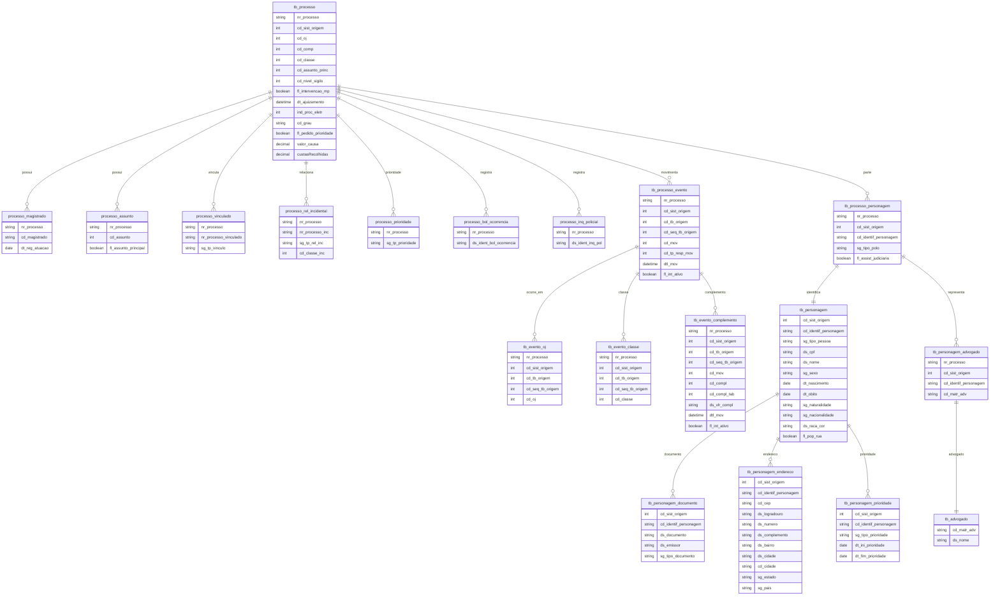

# DER original (transcricao do DER.png)

Origem: `docs/DER.png`
Objetivo: reproduzir o DER original com os mesmos nomes de tabelas/campos, para comparacao com o DER proposto.

## Observacoes
- Este DER reproduz os nomes de tabelas/campos do `DER.png`.
- Caso algum campo esteja divergente, me sinalize a caixa/tabela para eu ajustar pontualmente.
