# DER (canonico compacto) baseado no XSD 1.2 - ramo processojudicial

Origem: `utils/modelo-de-transferencia-de-dados-1.2.xsd`
Estrategia: relacionamentos 1-para-1 foram colapsados em atributos da entidade principal para reduzir a complexidade. Mantem apenas tabelas necessarias para cardinalidades 0..* / 1..* e choices.

## 1) DER compacto (Mermaid ER)

```mermaid
erDiagram
  PROCESSO {
    string nr_processo PK
    string numero_processo
    int competencia
    int classe_processual
    string codigo_localidade_ibge
    int nivel_sigilo
    boolean intervencao_mp
    int tamanho_processo_bytes
    datetime data_ajuizamento
    int proc_el
    int dsc_sistema
    boolean juizo_100_digital
    int ano_eleicao
    string sigla_tribunal
    string grau
    boolean pedido_prioridade
    decimal valor_causa
    decimal custas_iniciais
    decimal custas_recursais
    decimal custas_finais
    decimal custas_recolhidas
    int orgao_codigo
    string orgao_nome
    string orgao_instancia
    string orgao_municipio_ibge
  }

  PROCESSO_PARAMETRO {
    string nr_processo FK
    string nome
    string valor
  }

  PROCESSO_OUTRO_NUMERO {
    string nr_processo FK
    string numero
  }

  PROCESSO_PRIORIDADE {
    string nr_processo FK
    string tipo_prioridade
  }

  PROCESSO_BOLETIM_OCORRENCIA {
    string nr_processo FK
    string numero_boletim
  }

  PROCESSO_INQUERITO_POLICIAL {
    string nr_processo FK
    string numero_inquerito
  }

  PROCESSO_VINCULADO {
    string nr_processo FK
    string numero_processo_vinculado
    string vinculo
  }

  RELACAO_INCIDENTAL {
    string nr_processo FK
    string numero_processo
    string tipo_relacao
    int classe_processual
  }

  PROCESSO_ASSUNTO {
    string nr_processo PK, FK
    int codigo_assunto PK
    boolean principal
  }

  PARTE_PROCESSUAL {
    string nr_processo PK, FK
    int cd_sist_origem PK
    int cd_tb_origem PK
    int cd_seq_tb_origem PK
    string tipo_polo
    boolean assistencia_judiciaria
    date assistencia_deferimento
    date assistencia_revogacao
    int intimacao_pendente
    string relacionamento_processual
    string interesse_publico
  }

  PESSOA {
    int cd_sist_origem PK
    int cd_seq_tb_origem PK
    string nome
    string sexo
    string nome_genitor
    string nome_genitora
    date data_nascimento
    date data_obito
    string numero_documento_principal
    string tipo_pessoa
    string raca_cor
    string cidade_natural
    string estado_natural
    string nacionalidade
    string email
    boolean populacao_de_rua
  }

  PESSOA_OUTRO_NOME {
    int cd_sist_origem FK
    int cd_seq_tb_origem FK
    string outro_nome
  }

  DOCUMENTO_IDENTIFICACAO {
    string id_documento_id PK
    int cd_sist_origem FK
    int cd_seq_tb_origem FK
    string codigo_documento
    string emissor_documento
    string tipo_documento
    string nome_no_documento
  }

  ENDERECO {
    string id_endereco PK
    int cd_sist_origem FK
    int cd_seq_tb_origem FK
    string cep
    string logradouro
    string numero
    string complemento
    string bairro
    string cidade
    string cod_cidade_ibge
    string estado
    string pais
  }

  PESSOA_RELACIONADA {
    int cd_sist_origem FK
    int cd_seq_tb_origem FK
    int cd_sist_origem_relacionada FK
    int cd_seq_tb_origem_relacionada FK
    string modalidade_relacionamento
  }

  PESSOA_VINCULADA {
    int cd_sist_origem FK
    int cd_seq_tb_origem FK
    int cd_sist_origem_vinculada FK
    int cd_seq_tb_origem_vinculada FK
  }

  REPRESENTANTE_PROCESSUAL {
    int cd_sist_origem PK
    int cd_seq_tb_origem PK
    string nome
    string inscricao_oab
    string numero_documento_principal
    boolean intimacao_preferencial
    string tipo_representante
  }

  REPRESENTANTE_ENDERECO {
    int cd_sist_origem FK
    int cd_seq_tb_origem FK
    string cep
    string logradouro
    string numero
    string complemento
    string bairro
    string cidade
    string cod_cidade_ibge
    string estado
    string pais
  }

  PARTE_REPRESENTANTE {
    string nr_processo FK
    int cd_sist_origem_parte FK
    int cd_tb_origem_parte FK
    int cd_seq_tb_origem_parte FK
    int cd_sist_origem_rep FK
    int cd_seq_tb_origem_rep FK
  }

  PRIORIDADE_PARTE {
    string nr_processo FK
    int cd_sist_origem FK
    int cd_tb_origem FK
    int cd_seq_tb_origem FK
    string tipo_prioridade
    date data_concessao
    date data_fim
  }

  MOVIMENTO_PROCESSUAL {
    string nr_processo PK
    int cd_sist_origem PK
    int cd_tb_origem PK
    int cd_seq_tb_origem PK
    datetime data_hora
    int nivel_sigilo
    string identificador_movimento
    string responsavel_movimento
    int tipo_responsavel_movimento
    int tipo_decisao
    int classe_processual
    int codigo_nacional
    int orgao_codigo
    string orgao_nome
    string orgao_instancia
    string orgao_municipio_ibge
    int orgao_colegiado_codigo
    string orgao_colegiado_nome
    string orgao_colegiado_instancia
    string orgao_colegiado_municipio_ibge
  }

  COMPLEMENTO_MOVIMENTO_TEXTO {
    string nr_processo FK
    int cd_sist_origem FK
    int cd_tb_origem FK
    int cd_seq_tb_origem FK
    string complemento_texto
  }

  COMPLEMENTO_MOVIMENTO_NACIONAL {
    string nr_processo FK
    int cd_sist_origem FK
    int cd_tb_origem FK
    int cd_seq_tb_origem FK
    int codigo_complemento
    string descricao_complemento
    int codigo_complemento_tabelado
  }

  MOVIMENTO_MAGISTRADO_PROLATOR {
    string nr_processo FK
    int cd_sist_origem FK
    int cd_tb_origem FK
    int cd_seq_tb_origem FK
    string cpf_magistrado
  }

  MOVIMENTO_DOCUMENTO_VINCULADO {
    string nr_processo FK
    int cd_sist_origem FK
    int cd_tb_origem FK
    int cd_seq_tb_origem FK
    string id_documento FK
  }

  DOCUMENTO {
    string id_documento PK
    string nr_processo FK
    string id_documento_vinculado
    string tipo_documento
    datetime data_hora
    string mimetype
    int nivel_sigilo
    int movimento
    string hash
    string descricao
    string tipo_documento_local
    blob conteudo
  }

  DOCUMENTO_RELACAO {
    string id_documento_pai FK
    string id_documento_filho FK
  }

  ASSINATURA_DOCUMENTO {
    string id_documento FK
    string assinatura
    datetime data_assinatura
    string cadeia_certificado
    string algoritmo_hash
    string codificacao_certificado
  }

  SIGNATARIO_LOGIN {
    string id_documento FK
    string identificador
    datetime data_hora
  }

  DOCUMENTO_PARAMETRO {
    string id_documento FK
    string nome
    string valor
  }

  %% Relacoes
  PROCESSO ||--o{ PROCESSO_PARAMETRO : outroParametro
  PROCESSO ||--o{ PROCESSO_OUTRO_NUMERO : outrosnumeros
  PROCESSO ||--o{ PROCESSO_PRIORIDADE : tipoPrioridade
  PROCESSO ||--o{ PROCESSO_BOLETIM_OCORRENCIA : numeroBoletimOcorrencia
  PROCESSO ||--o{ PROCESSO_INQUERITO_POLICIAL : numeroInqueritoPolicial
  PROCESSO ||--o{ PROCESSO_VINCULADO : processoVinculado
  PROCESSO ||--o{ RELACAO_INCIDENTAL : relacaoIncidental
  PROCESSO ||--o{ PROCESSO_ASSUNTO : assunto

  PROCESSO ||--o{ PARTE_PROCESSUAL : parte
  PESSOA ||--o{ PARTE_PROCESSUAL : pessoa
  PESSOA ||--o{ PESSOA_OUTRO_NOME : outroNome
  PESSOA ||--o{ DOCUMENTO_IDENTIFICACAO : documento
  PESSOA ||--o{ ENDERECO : endereco
  PESSOA ||--o{ PESSOA_RELACIONADA : pessoaRelacionada
  PESSOA ||--o{ PESSOA_VINCULADA : pessoaVinculada

  PARTE_PROCESSUAL ||--o{ PARTE_REPRESENTANTE : advogado
  REPRESENTANTE_PROCESSUAL ||--o{ PARTE_REPRESENTANTE : representa
  REPRESENTANTE_PROCESSUAL ||--o{ REPRESENTANTE_ENDERECO : endereco
  PARTE_PROCESSUAL ||--o{ PRIORIDADE_PARTE : prioridade

  PROCESSO ||--o{ MOVIMENTO_PROCESSUAL : movimento
  MOVIMENTO_PROCESSUAL ||--o{ COMPLEMENTO_MOVIMENTO_TEXTO : complemento
  MOVIMENTO_PROCESSUAL ||--o{ COMPLEMENTO_MOVIMENTO_NACIONAL : complementoNacional
  MOVIMENTO_PROCESSUAL ||--o{ MOVIMENTO_MAGISTRADO_PROLATOR : magistradoProlator
  MOVIMENTO_PROCESSUAL ||--o{ MOVIMENTO_DOCUMENTO_VINCULADO : idDocumentoVinculado

  PROCESSO ||--o{ DOCUMENTO : documento
  DOCUMENTO ||--o{ ASSINATURA_DOCUMENTO : assinatura
  DOCUMENTO ||--o{ SIGNATARIO_LOGIN : signatarioLogin
  DOCUMENTO ||--o{ DOCUMENTO_PARAMETRO : outroParametro
  DOCUMENTO ||--o{ DOCUMENTO_RELACAO : documentoVinculado
```

## 2) O que foi colapsado (1-para-1)
- `tipoProcessoJudicial` + `tipoCabecalhoProcesso` -> `PROCESSO`
- `orgaoJulgador` do cabecalho -> campos `orgao_*` em `PROCESSO`
- `siglaTribunal`, `grau`, `pedidoPrioridade`, `valorCausa`, `custas*` -> colunas de `PROCESSO`
- `assunto` (somente nacional) -> `PROCESSO_ASSUNTO` com `codigo_assunto`
- `movimentoNacional` -> `codigo_nacional` em `MOVIMENTO_PROCESSUAL` (movimento local removido)
- `orgaoJulgador` / `orgaoJulgadorColegiado` de movimento -> colunas `orgao_*` e `orgao_colegiado_*` em `MOVIMENTO_PROCESSUAL`
- `interessePublico` -> coluna `interesse_publico` em `PARTE_PROCESSUAL`
- `polo` -> coluna `tipo_polo` em `PARTE_PROCESSUAL` (entidade POLO removida)

## 3) Observacoes
- O colapso reduz tabelas e joins, mas aumenta colunas nulas em outros pontos do modelo.
- Ainda e necessario manter tabelas 0..* (enderecos, documentos, prioridades, complementos, etc.) para preservar multiplicidade do XSD.
- Chave de processo: `nr_processo` (CNJ), sem casos de numeros provisorios.
- Movimentos identificados por chave composta: `nr_processo + cd_sist_origem + cd_tb_origem + cd_seq_tb_origem`.
- Assuntos: chave composta `nr_processo + codigo_assunto` em `PROCESSO_ASSUNTO`.
- Partes: chave composta `nr_processo + cd_sist_origem + cd_tb_origem + cd_seq_tb_origem`.
- Restricao: uma pessoa nao pode aparecer em polos diferentes no mesmo processo (impor UNIQUE em `nr_processo + cd_sist_origem + cd_seq_tb_origem` em `PARTE_PROCESSUAL`).
- Prioridade permanece associada a parte, com data de concessao.
- Se quiser, posso adicionar checks (ex.: `codigo_nacional` obrigatorio para movimentos).
