# DER (canonico) baseado no XSD 1.2 - ramo processojudicial

Origem: `utils/modelo-de-transferencia-de-dados-1.2.xsd`
Escopo: `tipoProcessoJudicial` e tipos dependentes. Este DER representa a estrutura canonica do XSD, com campos e parametrizacoes (enumeracoes/padroes) conforme definidos no schema e na documentacao do XSD.

## 1) DER (Mermaid ER)

```mermaid
erDiagram
  TIPO_PROCESSO_JUDICIAL {
    string id_processo PK
  }

  CABECALHO_PROCESSO {
    string id_processo PK, FK
    string numero_processo
    int competencia
    int classe_processual
    string codigo_localidade_ibge
    int nivel_sigilo
    boolean intervencao_mp
    int tamanho_processo_bytes
    datetime data_ajuizamento
    int proc_el
    int dsc_sistema
    boolean juizo_100_digital
    int ano_eleicao
  }

  PROCESSO_SIGLA_TRIBUNAL {
    string id_processo FK
    string sigla_tribunal
  }

  PROCESSO_GRAU {
    string id_processo FK
    string grau
  }

  PROCESSO_PARAMETRO {
    string id_processo FK
    string nome
    string valor
  }

  PROCESSO_OUTRO_NUMERO {
    string id_processo FK
    string numero
  }

  PROCESSO_CUSTAS {
    string id_processo FK
    decimal valor_causa
    decimal custas_iniciais
    decimal custas_recursais
    decimal custas_finais
    decimal custas_recolhidas
  }

  PROCESSO_PRIORIDADE {
    string id_processo FK
    string tipo_prioridade
  }

  PROCESSO_BOLETIM_OCORRENCIA {
    string id_processo FK
    string numero_boletim
  }

  PROCESSO_INQUERITO_POLICIAL {
    string id_processo FK
    string numero_inquerito
  }

  ORGAO_JULGADOR {
    int codigo_orgao PK
    string nome_orgao
    string instancia
    string codigo_municipio_ibge
  }

  PROCESSO_ORGAO_JULGADOR {
    string id_processo FK
    int codigo_orgao FK
  }

  POLO_PROCESSUAL {
    string id_polo PK
    string id_processo FK
    string tipo_polo
  }

  PARTE_PROCESSUAL {
    string id_parte PK
    string id_polo FK
    boolean assistencia_judiciaria
    date assistencia_deferimento
    date assistencia_revogacao
    int intimacao_pendente
    string relacionamento_processual
  }

  INTERESSE_PUBLICO {
    string id_parte FK
    string descricao
  }

  PESSOA {
    string id_pessoa PK
    string nome
    string sexo
    string nome_genitor
    string nome_genitora
    date data_nascimento
    date data_obito
    string numero_documento_principal
    string tipo_pessoa
    string raca_cor
    string cidade_natural
    string estado_natural
    string nacionalidade
    string email
    boolean populacao_de_rua
  }

  PARTE_PESSOA {
    string id_parte FK
    string id_pessoa FK
  }

  PESSOA_OUTRO_NOME {
    string id_pessoa FK
    string outro_nome
  }

  DOCUMENTO_IDENTIFICACAO {
    string id_documento_id PK
    string id_pessoa FK
    string codigo_documento
    string emissor_documento
    string tipo_documento
    string nome_no_documento
  }

  ENDERECO {
    string id_endereco PK
    string id_pessoa FK
    string cep
    string logradouro
    string numero
    string complemento
    string bairro
    string cidade
    string cod_cidade_ibge
    string estado
    string pais
  }

  PESSOA_RELACIONADA {
    string id_pessoa FK
    string id_pessoa_relacionada FK
    string modalidade_relacionamento
  }

  PESSOA_VINCULADA {
    string id_pessoa FK
    string id_pessoa_vinculada FK
  }

  REPRESENTANTE_PROCESSUAL {
    string id_representante PK
    string nome
    string inscricao_oab
    string numero_documento_principal
    boolean intimacao_preferencial
    string tipo_representante
  }

  REPRESENTANTE_ENDERECO {
    string id_representante FK
    string cep
    string logradouro
    string numero
    string complemento
    string bairro
    string cidade
    string cod_cidade_ibge
    string estado
    string pais
  }

  PARTE_REPRESENTANTE {
    string id_parte FK
    string id_representante FK
  }

  PRIORIDADE_PARTE {
    string id_parte FK
    string tipo_prioridade
    date data_concessao
    date data_fim
  }

  PROCESSO_VINCULADO {
    string id_processo FK
    string numero_processo_vinculado
    string vinculo
  }

  RELACAO_INCIDENTAL {
    string id_processo FK
    string numero_processo
    string tipo_relacao
    int classe_processual
  }

  ASSUNTO_PROCESSUAL {
    string id_assunto PK
    boolean principal
  }

  ASSUNTO_NACIONAL {
    string id_assunto FK
    int codigo_nacional
  }

  ASSUNTO_LOCAL {
    string id_assunto FK
    int codigo_assunto
    int codigo_pai_nacional
    string descricao
  }

  ASSUNTO_LOCAL_PAI {
    string id_assunto_local_filho FK
    string id_assunto_local_pai FK
  }

  PROCESSO_ASSUNTO {
    string id_processo FK
    string id_assunto FK
  }

  MOVIMENTO_PROCESSUAL {
    string id_movimento PK
    string id_processo FK
    datetime data_hora
    int nivel_sigilo
    string identificador_movimento
    string responsavel_movimento
    int tipo_responsavel_movimento
    int tipo_decisao
    int classe_processual
  }

  MOVIMENTO_NACIONAL {
    string id_movimento FK
    int codigo_nacional
  }

  MOVIMENTO_LOCAL {
    string id_movimento FK
    int codigo_movimento
    int codigo_pai_nacional
    string descricao
  }

  MOVIMENTO_LOCAL_PAI {
    string id_movimento_local_filho FK
    string id_movimento_local_pai FK
  }

  COMPLEMENTO_MOVIMENTO_TEXTO {
    string id_movimento FK
    string complemento_texto
  }

  COMPLEMENTO_MOVIMENTO_NACIONAL {
    string id_movimento FK
    int codigo_complemento
    string descricao_complemento
    int codigo_complemento_tabelado
  }

  MOVIMENTO_MAGISTRADO_PROLATOR {
    string id_movimento FK
    string cpf_magistrado
  }

  MOVIMENTO_DOCUMENTO_VINCULADO {
    string id_movimento FK
    string id_documento FK
  }

  MOVIMENTO_ORGAO_JULGADOR {
    string id_movimento FK
    int codigo_orgao FK
    string tipo_orgao
  }

  DOCUMENTO {
    string id_documento PK
    string id_processo FK
    string id_documento_vinculado
    string tipo_documento
    datetime data_hora
    string mimetype
    int nivel_sigilo
    int movimento
    string hash
    string descricao
    string tipo_documento_local
    blob conteudo
  }

  DOCUMENTO_RELACAO {
    string id_documento_pai FK
    string id_documento_filho FK
  }

  ASSINATURA_DOCUMENTO {
    string id_documento FK
    string assinatura
    datetime data_assinatura
    string cadeia_certificado
    string algoritmo_hash
    string codificacao_certificado
  }

  SIGNATARIO_LOGIN {
    string id_documento FK
    string identificador
    datetime data_hora
  }

  DOCUMENTO_PARAMETRO {
    string id_documento FK
    string nome
    string valor
  }

  %% Relacoes
  TIPO_PROCESSO_JUDICIAL ||--|| CABECALHO_PROCESSO : dadosBasicos
  CABECALHO_PROCESSO ||--o{ PROCESSO_SIGLA_TRIBUNAL : siglaTribunal
  CABECALHO_PROCESSO ||--o{ PROCESSO_GRAU : grau
  CABECALHO_PROCESSO ||--o{ PROCESSO_PARAMETRO : outroParametro
  CABECALHO_PROCESSO ||--o{ PROCESSO_OUTRO_NUMERO : outrosnumeros
  CABECALHO_PROCESSO ||--|| PROCESSO_CUSTAS : custas
  CABECALHO_PROCESSO ||--o{ PROCESSO_PRIORIDADE : tipoPrioridade
  CABECALHO_PROCESSO ||--o{ PROCESSO_BOLETIM_OCORRENCIA : numeroBoletimOcorrencia
  CABECALHO_PROCESSO ||--o{ PROCESSO_INQUERITO_POLICIAL : numeroInqueritoPolicial
  CABECALHO_PROCESSO ||--|| PROCESSO_ORGAO_JULGADOR : orgaoJulgador
  ORGAO_JULGADOR ||--o{ PROCESSO_ORGAO_JULGADOR : referencia

  CABECALHO_PROCESSO ||--o{ POLO_PROCESSUAL : polo
  POLO_PROCESSUAL ||--o{ PARTE_PROCESSUAL : parte
  PARTE_PROCESSUAL ||--o{ INTERESSE_PUBLICO : interessePublico
  PARTE_PROCESSUAL ||--o{ PARTE_PESSOA : pessoa
  PESSOA ||--o{ PARTE_PESSOA : referencia
  PESSOA ||--o{ PESSOA_OUTRO_NOME : outroNome
  PESSOA ||--o{ DOCUMENTO_IDENTIFICACAO : documento
  PESSOA ||--o{ ENDERECO : endereco
  PESSOA ||--o{ PESSOA_RELACIONADA : pessoaRelacionada
  PESSOA ||--o{ PESSOA_VINCULADA : pessoaVinculada

  PARTE_PROCESSUAL ||--o{ PARTE_REPRESENTANTE : advogado
  REPRESENTANTE_PROCESSUAL ||--o{ PARTE_REPRESENTANTE : representa
  REPRESENTANTE_PROCESSUAL ||--o{ REPRESENTANTE_ENDERECO : endereco
  PARTE_PROCESSUAL ||--o{ PRIORIDADE_PARTE : prioridade

  CABECALHO_PROCESSO ||--o{ PROCESSO_VINCULADO : processoVinculado
  CABECALHO_PROCESSO ||--o{ RELACAO_INCIDENTAL : relacaoIncidental

  CABECALHO_PROCESSO ||--o{ PROCESSO_ASSUNTO : assunto
  PROCESSO_ASSUNTO ||--|| ASSUNTO_PROCESSUAL : assunto
  ASSUNTO_PROCESSUAL ||--o{ ASSUNTO_NACIONAL : codigoNacional
  ASSUNTO_PROCESSUAL ||--o{ ASSUNTO_LOCAL : assuntoLocal
  ASSUNTO_LOCAL ||--o{ ASSUNTO_LOCAL_PAI : pai

  TIPO_PROCESSO_JUDICIAL ||--o{ MOVIMENTO_PROCESSUAL : movimento
  MOVIMENTO_PROCESSUAL ||--o{ MOVIMENTO_NACIONAL : movimentoNacional
  MOVIMENTO_PROCESSUAL ||--o{ MOVIMENTO_LOCAL : movimentoLocal
  MOVIMENTO_LOCAL ||--o{ MOVIMENTO_LOCAL_PAI : pai
  MOVIMENTO_PROCESSUAL ||--o{ COMPLEMENTO_MOVIMENTO_TEXTO : complemento
  MOVIMENTO_PROCESSUAL ||--o{ COMPLEMENTO_MOVIMENTO_NACIONAL : complementoNacional
  MOVIMENTO_PROCESSUAL ||--o{ MOVIMENTO_MAGISTRADO_PROLATOR : magistradoProlator
  MOVIMENTO_PROCESSUAL ||--o{ MOVIMENTO_DOCUMENTO_VINCULADO : idDocumentoVinculado
  MOVIMENTO_PROCESSUAL ||--o{ MOVIMENTO_ORGAO_JULGADOR : orgaoJulgador
  ORGAO_JULGADOR ||--o{ MOVIMENTO_ORGAO_JULGADOR : referencia

  TIPO_PROCESSO_JUDICIAL ||--o{ DOCUMENTO : documento
  DOCUMENTO ||--o{ ASSINATURA_DOCUMENTO : assinatura
  DOCUMENTO ||--o{ SIGNATARIO_LOGIN : signatarioLogin
  DOCUMENTO ||--o{ DOCUMENTO_PARAMETRO : outroParametro
  DOCUMENTO ||--o{ DOCUMENTO_RELACAO : documentoVinculado
```

## 2) Enumeracoes e parametrizacoes (XSD)

### 2.1 Pessoa
- `sexo` (modalidadeGeneroPessoa): M, F, D
- `tipo_pessoa` (tipoQualificacaoPessoa): fisica, juridica, autoridade, orgaorepresentacao, ente despersonalizado
- `raca_cor` (tipoRacaCorPessoa): Branco(a), Pardo(a), Preto(a), Indigena, Amarelo(a), Nao declarado
- `nacionalidade`: ISO-3166-1-alpha-2 (padrao BR)
- `estado_natural`: UF 2 letras

### 2.2 Representante processual
- `tipo_representante` (modalidadeRepresentanteProcessual): A, E, M, D, P

### 2.3 Polo processual
- `tipo_polo` (modalidadePoloProcessual): AT, PA, TC, FL, TJ, AD, VI, CI

### 2.4 Relacionamento processual
- `relacionamento_processual` (modalidadeRelacionamentoProcessual): CP, RP, TF, AT, AS

### 2.5 Relacionamento pessoal
- `modalidade_relacionamento` (modalidadesRelacionamentoPessoal): P, AP, SP, T, C

### 2.6 Vinculacao processual
- `vinculo` (modalidadeVinculacaoProcesso): CX, CT, DP, AR, CD, RR, RG, OR

### 2.7 Prazo e comunicacao
- Nao aplicavel ao ramo processojudicial (apenas em comunicacao).

### 2.8 Orgao julgador
- `instancia`: ORIG, REV, ESP, EXT, ADM

### 2.9 Processo
- `numero_processo` (tipoNumeroUnico): 20 digitos
- `nivel_sigilo`: 0,1,2,3,4,5 (documentado no XSD)
- `proc_el`: 1=eletronico, 2=fisico
- `dsc_sistema`: 1=PJe, 2=Projudi, 3=SAJ, 4=EPROC, 5=Apolo, 6=Themis, 7=Libra, 8=Outros, 9=SEEU, 10=DCP, 11=EJUD, 12=SCPV, 13=Tucujuris
- `grau`: SUP, G2, TR, G1, JE, TRU, TNU, TEU, CJF, CSJT
- `sigla_tribunal`: conforme lista textual do XSD (STF, STJ, TJ*, TRF*, TRT*, TRE*, etc.)

### 2.10 Prioridade
- `tipo_prioridade` (tipoPrioridade): ID, RP, CA, PE, DG, VD, LC, OUT, PCD, FRJ, AT, TE, PS, PSR, VT, AMS, DI

### 2.11 Movimento processual
- `tipo_responsavel_movimento`: 0=Servidor, 1=Magistrado, 2=Automatico
- `tipo_decisao`: 0=Monocratica, 1=Colegiada
- `codigo_nacional` (movimento nacional): tabela Res. 46

### 2.12 Documento identificacao
- `tipo_documento` (modalidadeDocumentoIdentificador): CI, CNH, TE, CN, CC, PAS, CT, RIC, CMF, PIS_PASEP, CEI, NIT, CP, IF, OAB, RJC, RGE, NB, RIND, OUT

### 2.13 Endereco
- `cep`: 8 digitos

## 3) Cardinalidades principais (resumo)
- `tipoProcessoJudicial` -> `dadosBasicos` (1..1)
- `dadosBasicos` -> `polo` (1..*), `assunto` (1..*), `orgaoJulgador` (1..1)
- `polo` -> `parte` (1..*)
- `parte` -> `pessoa` OU `interessePublico` (choice 1)
- `processo` -> `movimento` (0..*), `documento` (0..*)
- `movimento` -> `movimentoNacional` OU `movimentoLocal` (choice 1)
- `documento` -> `documentoVinculado` (0..*)

---

Se quiser, posso converter este DER para:
1) DBML
2) draw.io (.drawio)
3) DDL SQL
